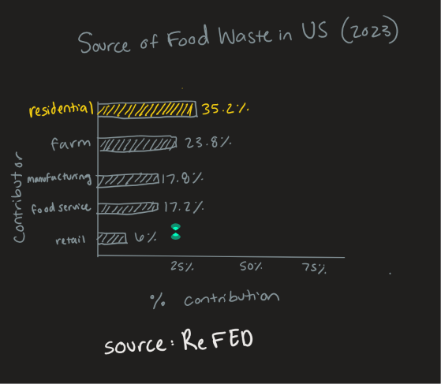
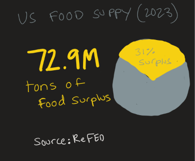
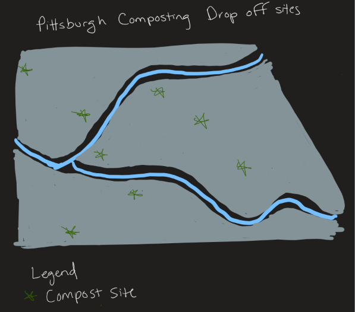

**Part 1 Final Project**

## Outline

For this project, I want to show how much food waste is generated (nationwide, statewide, and locally). There are different solutions to this issue like source reduction, donating extra food, feeding animals, industrial uses, and composting (City of Pittsburgh, 2025). Pittsburgh's 412 Food Rescue organization works to donate food surplus in Pittsburgh and in 2024 they redistributed 4.7 million pounds of food (412 Food Rescue, 2024.) There are other efforts that the city is doing to combat food waste, but a lot can still be done. 

Composting helps to reduce the methane emissions, conserves water, and makes more nutrient rich soil (EPA, 2026). While anyone can practice composting, there are some barriers to participation. In Pittsburgh, awareness of and access to composting practices seem limited. To get started with composting, one needs to create a bin to collect food scraps in and separate that from trash and recycling. While some people choose to keep their scraps to create soil for their own gardens, some choose to drop them off at local gardens or composting sites. Throughout Pittsburgh, the compost drop off sites are mostly limited to farmers markets, and there a few options for paid pick-up services. On CMU’s campus, there are drop off sites; however, these are not always correctly utilized. Oftentimes, I will see trash that does not belong in the compost bins. 

My call to action would be for students to make an effort to reduce their own food waste, and support composting practices where possible. These efforts aim to achieve less landfill waste, lower methane emissions, and healthier soil.

## Initial Sketches

**Source of Food Waste** 

Data Source: https://refed.org/downloads/refed-us-food-waste-report-2025.pdf

**Us Food Supply**

Data Source: https://refed.org/downloads/refed-us-food-waste-report-2025.pdf

**Compost Map Pittsburgh**

Data Source: https://data.wprdc.org/dataset/grow-pittsburgh-food-gardens/resource/dbdfcb3e-8fa5-4468-9b05-f69562798f7a

**Picture of Compost Bin at CMU**

*I plan to take a picture on campus of a compost bin. Potentially capturing one that is being misused, but hopefully I won't be able to find that :)*

## Methods
My plan is to use Tableau for all data visualizations regarding food waste and solutions to food waste. I will also use it for the map I create that shows the compost drop off sites. 

For the final presentation of my story and data visualizations I will create a shorthand page. 

## Data Sources
412 Food Rescue. (2024). 2024 Impact Report. https://412foodrescue.org/wp-content/uploads/2025/05/2024-Impact-Report-412-Food-Rescue.pdf

This source from 412 Food Rescue provides data on how much food donation in Pittsburgh has made an impact. While most of my data and story plans to focus on composting, I did want to mention and provide data on an important alternative solution to food waste. 

City of Pittsburgh. (2026). Farmers Market Overview. https://www.pittsburghpa.gov/Recreation-Events/Special-Events/Farmers-Markets 

With the data from the City of Pittsburgh Farmers Market Overview, I plan to pull the locations of the farmers markets into a spreadsheet with latitude and longitude to create a map with this data. 

City of Pittsburgh. (2025). Food Waste. https://www.pittsburghpa.gov/Business-Development/City-Planning/Sustainability/Food-Planning/Food-Waste

The data from the City of Pittsburgh is being used to communicate to the audience the different options for reducing food waste. It is a ranked order of most preferred to least preferred, so I will plan to create a bar graph for this visualization. 

Environmental Protection Agency. (2026). Benefits of Using Compost. https://www.epa.gov/sustainable-management-food/benefits-using-compost

I plan to use the EPA as a source to describe benefits of composting. 

ReFED (2025). From Surplus to Solutions. US Food Waste Report. Refed-us-food-waste-report-2025.pdf

The ReFED food waste report data will be used to help the audience understand how much food waste is produced in the US, and how individual households play a role in this waste. For visualizations, I will do a histogram for one and a large number combined with a pie chart for the other. This data source also offers stats on progress and trends in the U.S., so I plan to utilize that data to help show how it’s possible to move towards reducing waste. 

*No AI was used in this assignment*

